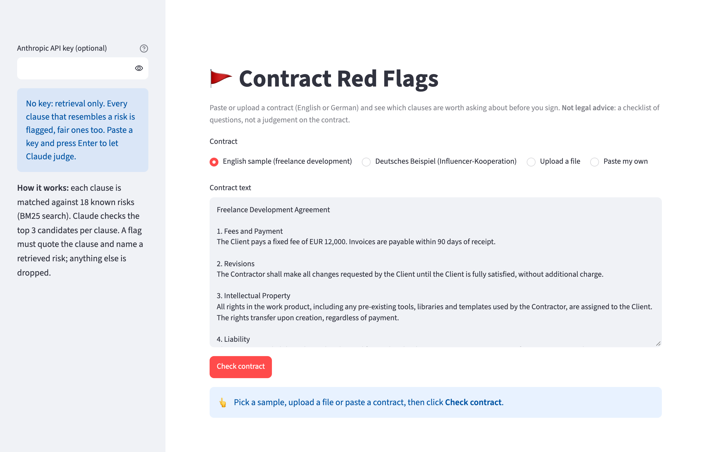
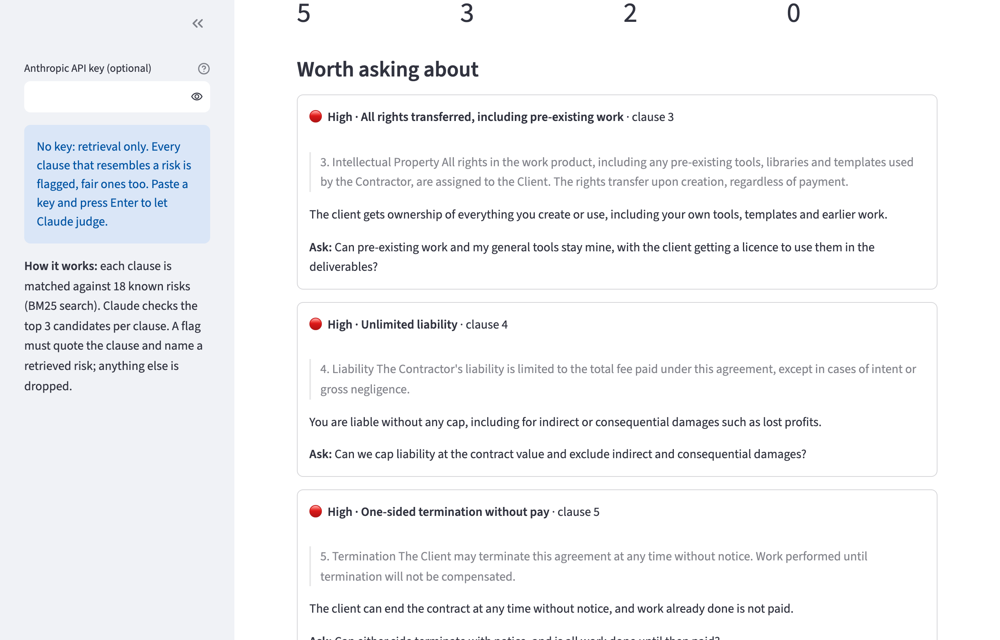

# contract-red-flags

Flag the clauses worth asking about **before you sign** a freelance, creator or agency contract, in
**English or German**. A small retrieval step (BM25) matches every clause against a bilingual knowledge
base of 18 known contract risks; Claude then decides which candidates really apply and explains why;
a guardrail keeps only flags that quote the clause and point to a retrieved risk. Severity and the
question to ask come from the knowledge base, not from the model.

> **Not legal advice.** The tool gives you a checklist of questions to raise. It does not say whether a
> contract is good, and it only knows the 18 risks in its knowledge base.

## Preview

Pick a sample, upload a `.txt`/`.md` file or paste a contract, then click **Check contract**:



Each flag shows severity, the risk, the exact wording, why it matters and what to ask. This screenshot
shows **retrieval only** (no API key): it flags clause 4 as "Unlimited liability" although that clause
*limits* liability to the fee. Retrieval sees the topic, not the meaning, which is the gap the Claude
step closes:



## Run it locally (step by step)

You need **Python 3.10+** and **git**. Everything runs on your own machine.

1. Get the code:
   ```bash
   git clone https://github.com/ExNNeph/contract-red-flags.git
   cd contract-red-flags
   ```
2. Create and activate a virtual environment, so nothing is installed system-wide:
   ```bash
   python3 -m venv .venv
   source .venv/bin/activate          # Windows: .venv\Scripts\activate
   ```
3. Install the project with the demo extras:
   ```bash
   pip install -e ".[demo]"
   ```
4. Start the demo:
   ```bash
   contract-flags demo
   ```
   Your browser opens **http://localhost:8501**. If it does not, open that address yourself.
5. Stop it with `Ctrl-C` in the terminal. Next time, only steps 2 (`source .venv/bin/activate`) and 4 are needed.

Things to try in the demo:
- Check the **English sample** without a key: retrieval flags the fair liability clause too.
- Paste your Anthropic key in the sidebar and **press Enter** (used for this session only, never stored),
  then check again: Claude keeps the real risks and drops the fair clause.
- Switch to the **German sample**: risk titles, explanations and questions come back in German.
- **Upload** one of the contracts in `evals/contracts/`, or your own as `.txt`/`.md`.
- Open **All clauses and their retrieved candidates** to see what BM25 found for each clause and how
  strongly it matched.

## How it works

1. `contract.py`: detects English or German and splits the contract into clauses (paragraphs and
   numbered lines such as `4.`, `§ 4`, `Section 4`), keeping each heading with its clause.
2. `knowledge.py`: `risks.json` holds 18 risks, each in both languages with title, description,
   severity, a question to ask and the phrases contracts typically use. A hand-written **BM25** index
   (one per language, with a crude suffix stemmer and stop-word list) returns the top 3 risks per clause.
3. `review.py`: Claude (`claude-opus-5-5`) gets every clause with its three candidates and returns flags
   through **structured outputs** (`output_config.format` with a JSON schema): clause, risk id, the exact
   words that create the risk, and an explanation in the contract's language. The prompt tells it to
   leave fair clauses on the same topic alone.
4. **Guardrail** (`grounded()`): a flag survives only if the clause exists, the risk was among *that
   clause's* retrieved candidates, and the quote appears in the clause. So Claude can neither invent a
   risk outside the knowledge base nor misquote the contract. Dropped flags are shown with the reason.
5. Without an API key, or if the call fails, the tool shows **retrieval only**: each clause's best match
   above a score threshold. It is also the baseline in the eval.

## Command line

```bash
contract-flags my-contract.txt
```

prints every flag sorted by severity with the quote, the explanation and the question to ask.

| Variable | Needed for |
|---|---|
| `ANTHROPIC_API_KEY` | Claude's judgement (optional; without it you get retrieval only) |
| `CONTRACT_FLAGS_MODEL` | override the model (default `claude-opus-5-5`) |

The request opts into the API's server-side refusal fallback (`fallbacks: "default"`).

## Evals

`evals/contracts/` holds six contracts, three English and three German (freelance development, creator
brand deal, agency subcontract, freier Mitarbeitervertrag, Influencer-Kooperation, Agentur-Rahmenvertrag).
`evals/gold.json` labels **34 red flags** (every one of the 18 risks at least once) by a unique piece of
the clause text, plus **9 fair clauses** that look like a risk but are fine: liability capped at the fee,
payment within 14 days, two revision rounds, a non-compete limited to named clients, paid exclusivity.

Two things are measured separately:
- **Retrieval recall@k**: is the labeled risk among the clause's top-k candidates? Claude can only flag
  what retrieval offers, so this caps the whole system.
- **Flags**: precision, recall and F1 on (clause, risk) pairs, and how many fair clauses got flagged.

```bash
python evals/run_eval.py 3        # retrieval + baseline; plus Claude when ANTHROPIC_API_KEY is set
pytest                            # unit tests + sanity checks on the labels
```

With a key, every extra and missed flag is printed per contract for error analysis.

## Results

Retrieval recall: **@1 94%, @3 100%, @5 100%**.

`python evals/run_eval.py 3` (Claude 3 runs per contract):

| method | flags | precision | recall | F1 | fair clauses flagged | guardrail drops |
|---|---|---|---|---|---|---|
| retrieval only (top match) | 43 | 74% | 94% | 83% | 9 / 9 | 0 |
| retrieval + Claude (`claude-opus-5-5`) + guardrail | 102 | **100%** | **100%** | **100%** | **0 / 27** | 0 |

Retrieval alone finds almost every red flag but also flags every fair clause, because the fair clauses
use the same words as the risky ones. It also misses the second risk when one clause holds two (for
example "all rights, including pre-existing tools" *and* "transfer upon creation, regardless of payment").

With Claude judging the retrieved candidates, all 34 red flags were found in each of the three runs,
in English and German, including both risks in the combined clauses, and none of the fair clauses was
flagged in any run. The guardrail never had to drop a flag.

Cost: about 2,400 input and 900 output tokens per contract, roughly $0.03 per contract at Opus 5.5
prices; the full run (18 Claude calls) cost about $0.49.

**What 100% means here:** the eval is saturated, so it can no longer tell a better prompt from a
worse one. It proves the pipeline works and the traps are handled, not that the tool is reliable on
real contracts. The contracts are short and clearly worded, and they share vocabulary with the
knowledge base because one person wrote both. The next step is a harder set: real-world legalese,
long clauses with nested exceptions ("except where…, provided that…"), risks split across two
clauses, and risks the knowledge base does not cover, to measure how often the tool stays silent
when it should not.

**Caveat on the 100% retrieval:** the knowledge base phrases and the eval contracts were written by the
same person, so they share vocabulary. Real contracts will retrieve worse; the next step is embeddings
or query expansion, measured with the same recall@k.

## Known limits

- 18 risks only. A clause that is risky in a way the knowledge base does not describe is not flagged.
- Small, synthetic eval (6 contracts, 34 flags, 9 fair clauses).
- Clause splitting expects paragraphs or numbered clauses; a contract without any structure becomes one
  long clause.
- No PDF input yet: copy the text or save it as `.txt`.

## License

MIT
